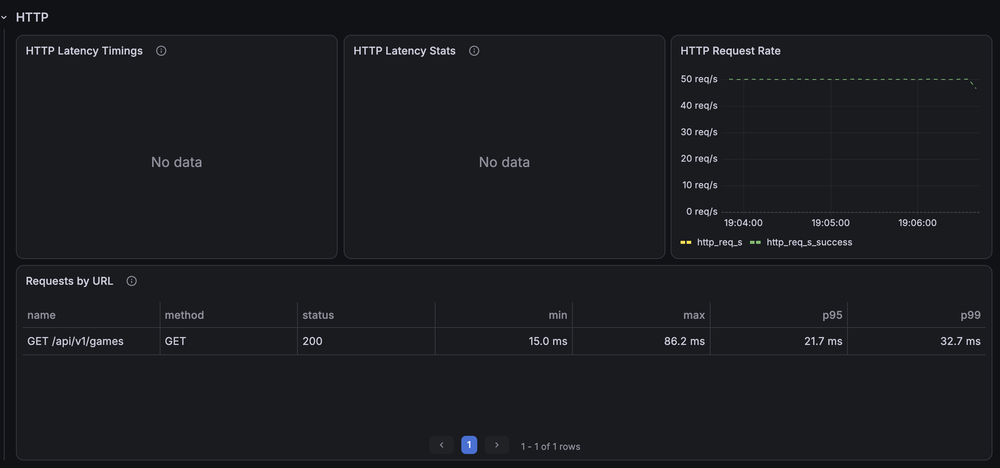
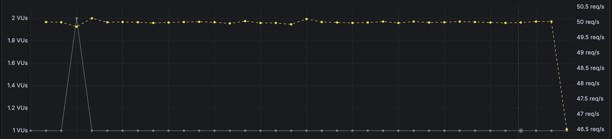
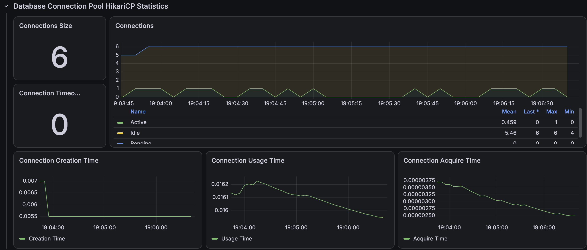

# 복합 필터 인덱스 개선 후

선택도와 정렬 조건을 고려한 복합 인덱스를 적용하고 개선 전과 동일한 부하로 3회 재검증했다.

```text
(city_name, game_status, match_format, deleted_date_time, start_date_time, game_id)
```

| 회차 | 평균 | p95 | p99 | 처리 요청 | 누락 |
|---|---:|---:|---:|---:|---:|
| Run 1 | 17.45ms | 20.49ms | 22.29ms | 9,001 | 0 |
| Run 2 | 17.79ms | 21.06ms | 26.53ms | 9,001 | 0 |
| Run 3 | 17.98ms | 21.50ms | 27.39ms | 9,001 | 0 |
| 3회 중앙값 | **17.79ms** | **21.06ms** | **26.53ms** | **9,001** | **0** |

| 지표 | 개선 전 | 개선 후 | 변화 |
|---|---:|---:|---:|
| p95 | 4,772.04ms | 21.06ms | **99.56% 감소** |
| 누락 | 528 | 0 | **100% 제거** |

## 증빙







- [Run 1 JSON](./k6/run-01-summary.json)
- [Run 2 JSON](./k6/run-02-summary.json)
- [Run 3 JSON](./k6/run-03-summary.json)
