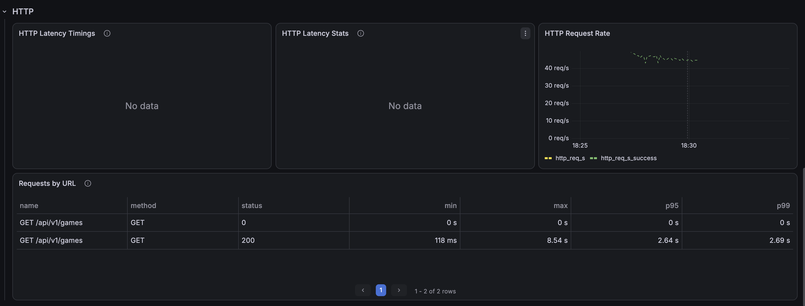
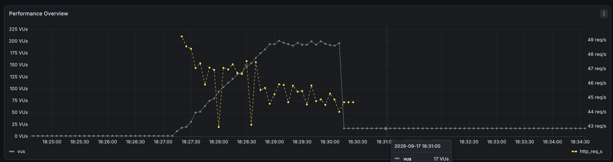
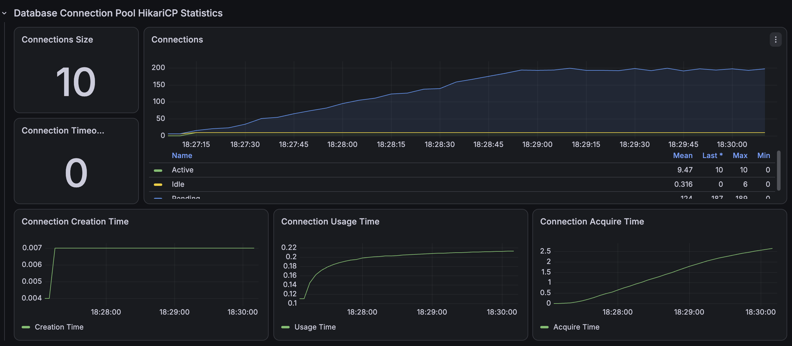

# 복합 필터 인덱스 개선 전

50만 건에서 지역·모집 상태·경기 형식·구장 형태를 결합한 목록을 50 RPS로 3분간 3회 조회했다.

```http
GET /api/v1/games?page=0&size=10&cityName=SEOUL&gameStatus=RECRUITING&matchFormat=FIVE_ON_FIVE&fieldStatus=OUTDOOR&sortType=START_TIME_ASC
```

| 회차 | 평균 | p95 | p99 | 처리 요청 | 누락 |
|---|---:|---:|---:|---:|---:|
| Run 1 | 2,991.42ms | 4,440.32ms | 4,519.36ms | 8,473 | 528 |
| Run 2 | 2,622.94ms | 4,793.65ms | 5,294.75ms | 8,469 | 532 |
| Run 3 | 2,488.52ms | 4,772.04ms | 4,864.71ms | 8,496 | 504 |
| 3회 중앙값 | **2,622.94ms** | **4,772.04ms** | **4,864.71ms** | **8,473** | **528** |

## 증빙







- [Run 1 JSON](./k6/run-01-summary.json)
- [Run 2 JSON](./k6/run-02-summary.json)
- [Run 3 JSON](./k6/run-03-summary.json)
