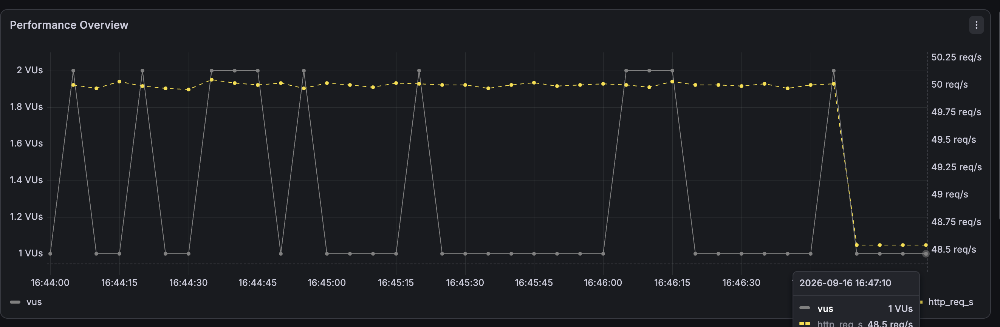
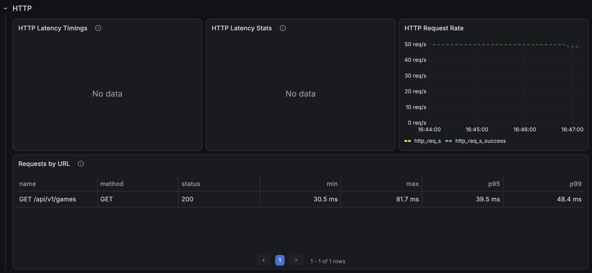
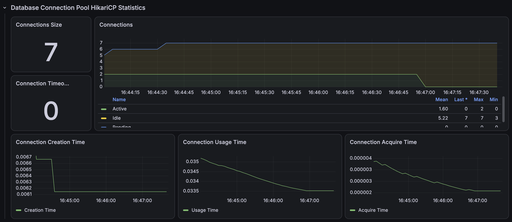

# 기본 경기 목록 인덱스 개선 후

동일한 50만 건 데이터와 50 RPS·3분 조건에서 목록 조회용 복합 인덱스를 적용한 후 3회 재검증했다.

```text
(deleted_date_time, start_date_time)
```

| 회차 | 평균 | p95 | p99 | 처리 요청 | 누락 |
|---|---:|---:|---:|---:|---:|
| Run 1 | 37.10ms | 40.58ms | 45.03ms | 9,001 | 0 |
| Run 2 | 33.95ms | 39.10ms | 41.94ms | 9,001 | 0 |
| Run 3 | 33.60ms | 38.54ms | 40.65ms | 9,001 | 0 |
| 3회 중앙값 | **33.95ms** | **39.10ms** | **41.94ms** | **9,001** | **0** |

| 지표 | 개선 전 | 개선 후 | 변화 |
|---|---:|---:|---:|
| p95 | 9,999.95ms | 39.10ms | **99.61% 감소** |
| 누락 | 4,980 | 0 | **100% 제거** |

## 증빙







- [Run 1 JSON](./k6/run-01-summary.json)
- [Run 2 JSON](./k6/run-02-summary.json)
- [Run 3 JSON](./k6/run-03-summary.json)
