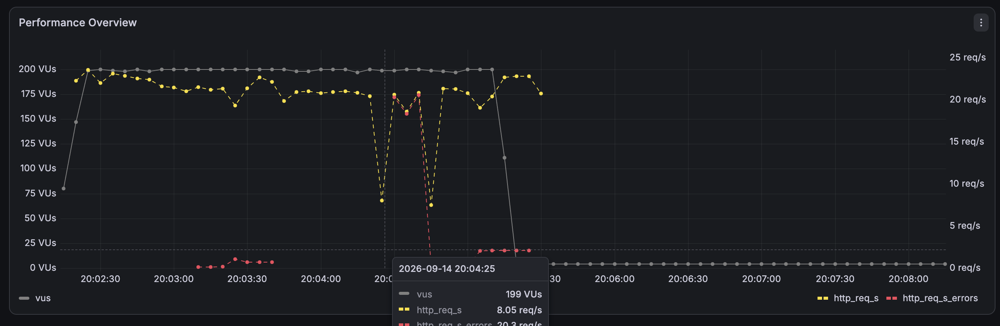
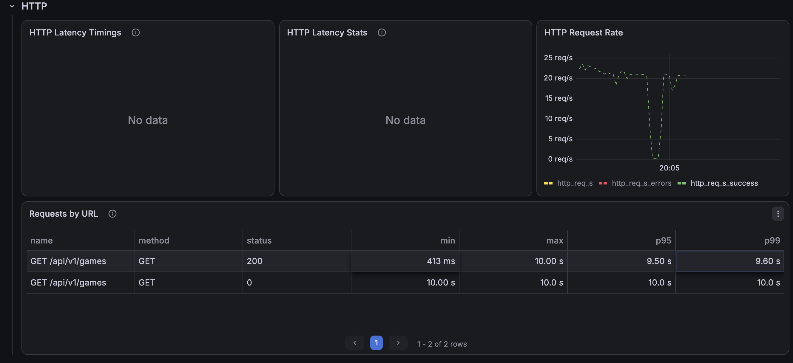
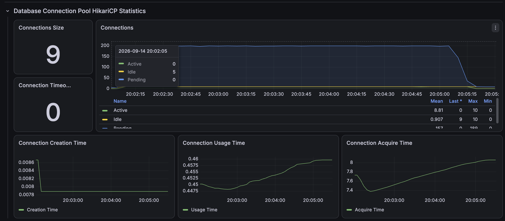

# 기본 경기 목록 인덱스 개선 전

50만 건의 경기 데이터에서 시작 시간순 목록을 50 RPS로 3분간 3회 조회한 최신 재검증 결과다.

```http
GET /api/v1/games?page=0&size=10&sortType=START_TIME_ASC
```

| 회차 | 평균 | p95 | p99 | 처리 요청 | 누락 |
|---|---:|---:|---:|---:|---:|
| Run 1 | 8,785.92ms | 9,718.93ms | 9,853.84ms | 4,068 | 4,933 |
| Run 2 | 8,868.37ms | 9,999.95ms | 10,000.56ms | 4,021 | 4,980 |
| Run 3 | 9,142.87ms | 10,078.33ms | 10,079.12ms | 3,914 | 5,087 |
| 3회 중앙값 | **8,868.37ms** | **9,999.95ms** | **10,000.56ms** | **4,021** | **4,980** |

목표 9,000건의 절반 이상을 스케줄하지 못했고 p95가 타임아웃 경계인 10초에 도달했다.

## 증빙







- [Run 1 JSON](./k6/run-01-summary.json)
- [Run 2 JSON](./k6/run-02-summary.json)
- [Run 3 JSON](./k6/run-03-summary.json)
