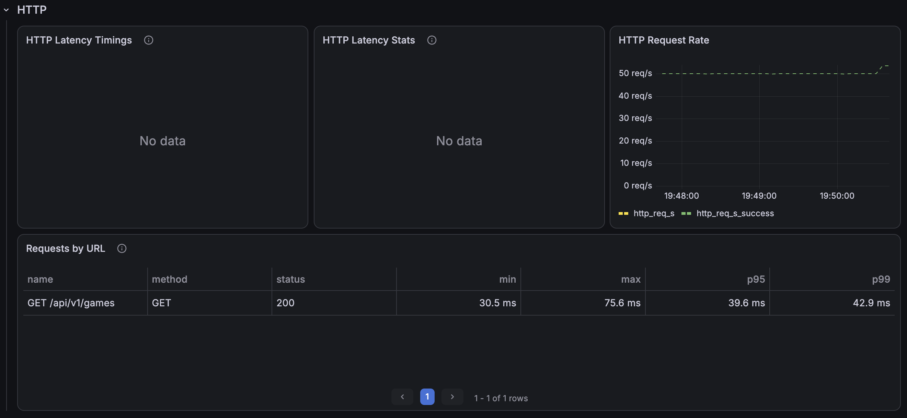
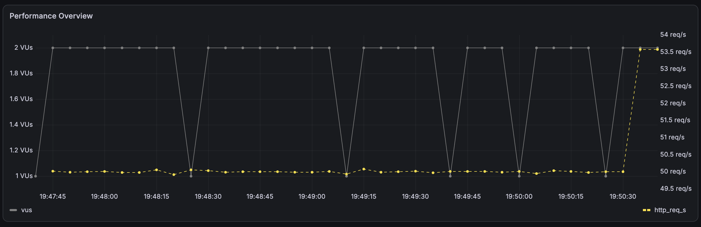
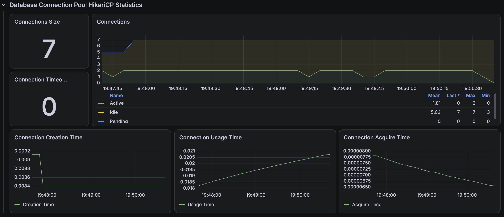

# 최신순 정렬 인덱스 개선 후

최신순 정렬과 COUNT 조회를 함께 고려한 커버링 인덱스를 적용한 후 동일한 부하로 3회 재검증했다.

```text
(deleted_date_time, created_at DESC, game_id DESC, start_date_time)
```

| 회차 | 평균 | p95 | p99 | 처리 요청 | 누락 |
|---|---:|---:|---:|---:|---:|
| Run 1 | 37.96ms | 41.85ms | 47.25ms | 9,001 | 0 |
| Run 2 | 34.17ms | 39.43ms | 41.51ms | 9,001 | 0 |
| Run 3 | 35.27ms | 40.70ms | 46.06ms | 9,001 | 0 |
| 3회 중앙값 | **35.27ms** | **40.70ms** | **46.06ms** | **9,001** | **0** |

| 지표 | 개선 전 | 개선 후 | 변화 |
|---|---:|---:|---:|
| p95 | 9,839.66ms | 40.70ms | **99.59% 감소** |
| 누락 | 4,404 | 0 | **100% 제거** |

## 증빙







- [Run 1 JSON](./k6/run-01-summary.json)
- [Run 2 JSON](./k6/run-02-summary.json)
- [Run 3 JSON](./k6/run-03-summary.json)
