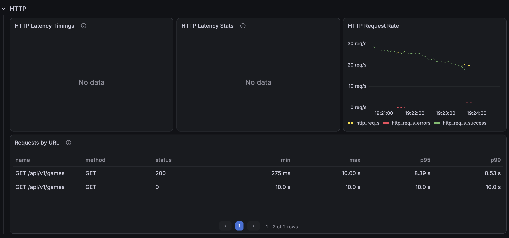
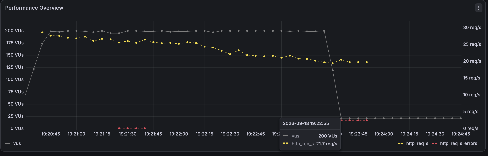
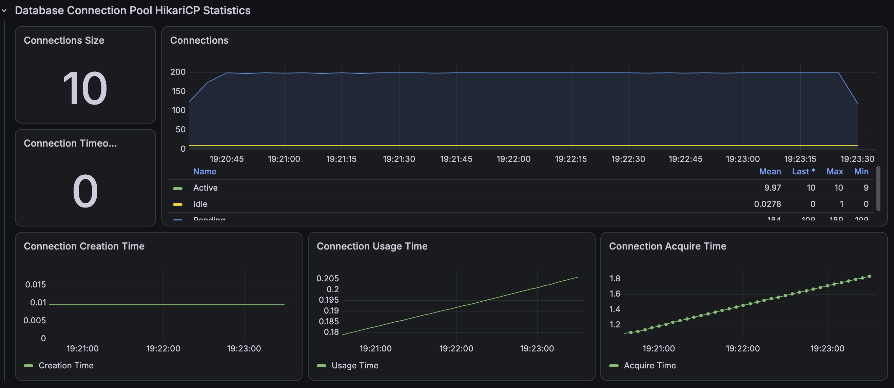

# 최신순 정렬 인덱스 개선 전

50만 건에서 최신순 목록을 50 RPS로 3분간 3회 조회한 본 테스트 결과다.

```http
GET /api/v1/games?page=0&size=10&sortType=LATEST
```

| 회차 | 평균 | p95 | p99 | 처리 요청 | 누락 |
|---|---:|---:|---:|---:|---:|
| Run 1 | 7,626.34ms | 9,630.02ms | 9,989.38ms | 4,650 | 4,350 |
| Run 2 | 7,706.34ms | 9,839.66ms | 9,981.76ms | 4,596 | 4,404 |
| Run 3 | 8,061.91ms | 9,859.51ms | 10,001.12ms | 4,404 | 4,596 |
| 3회 중앙값 | **7,706.34ms** | **9,839.66ms** | **9,989.38ms** | **4,596** | **4,404** |

정렬을 지원하는 인덱스가 없어 대량 탐색과 filesort가 발생했고, 목표 요청의 약 절반을 스케줄하지 못했다.

## 증빙







- [Run 1 JSON](./k6/run-01-summary.json)
- [Run 2 JSON](./k6/run-02-summary.json)
- [Run 3 JSON](./k6/run-03-summary.json)
