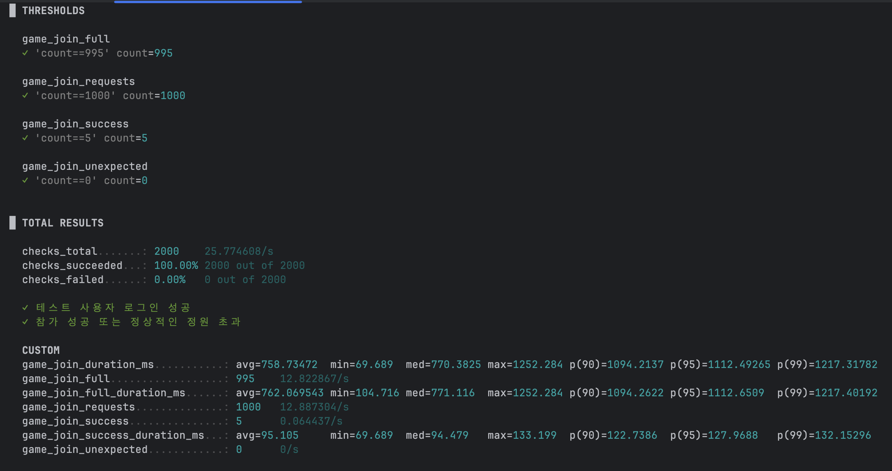
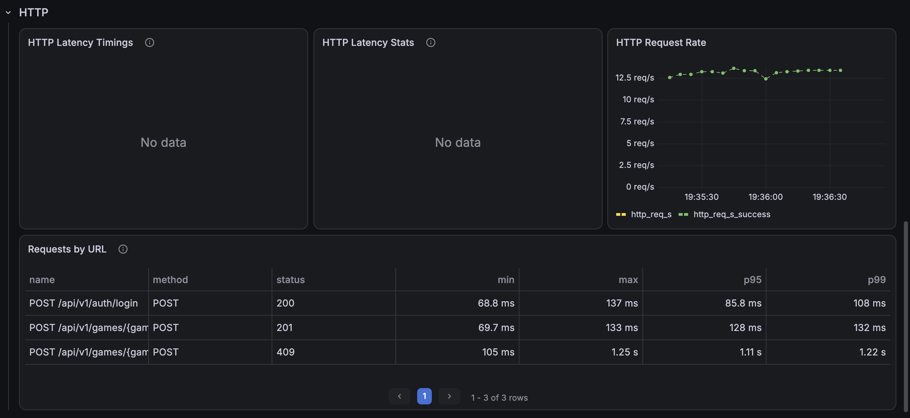
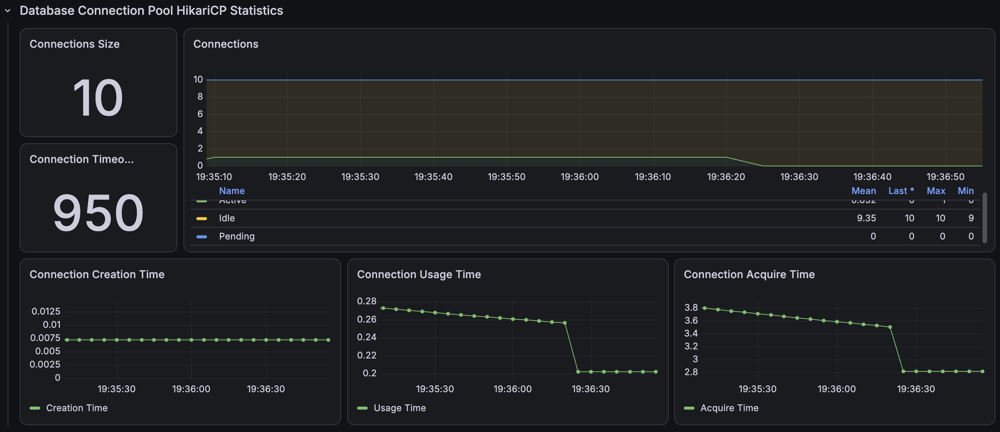
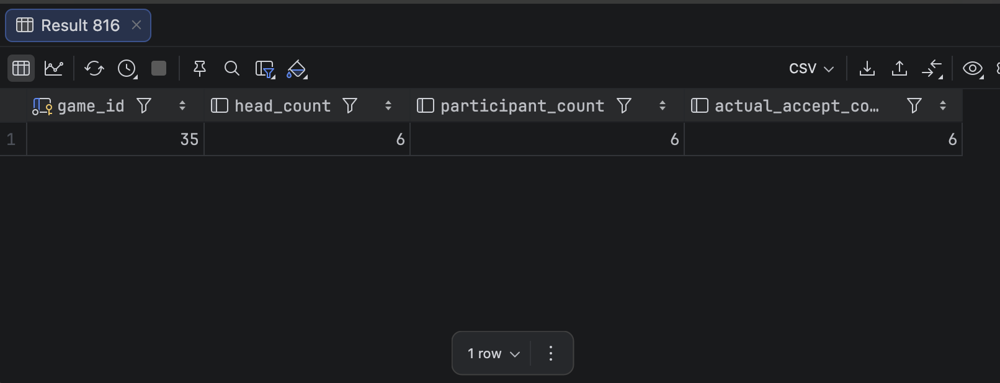

# 경기 참가 동시성 1,000 VU 본 테스트

경기 행에 `PESSIMISTIC_WRITE` 락을 적용해 같은 경기의 참가 변경을 순서화했다. 이후 사용자별 참가 이력 조회를 락 획득 후가 아닌 획득 전에 수행하고, 락 직후 경기 상태와 정원을 먼저 검증하도록 코드 위치를 조정했다.

```text
사용자별 기존 참가 조회
→ 경기 행 비관적 락 획득
→ 모집 상태·정원 검증
→ 참가 저장
```

## 1,000 VU 검증

정원 6명, 초기 참가 1명인 새 경기를 회차별로 생성하고, 1,000명이 각각 한 번씩 동시 참가했다.

| 회차 | 성공 | 정원 초과 | 비정상 | 정원 초과 응답 평균 | p95 | DB `ACCEPT` |
|---|---:|---:|---:|---:|---:|---:|
| Run 1 | 5 | 995 | 0 | 676.99ms | 1,053.58ms | 6 |
| Run 2 | 5 | 995 | 0 | 815.71ms | 1,465.42ms | 6 |
| Run 3 | 5 | 995 | 0 | 762.07ms | 1,112.65ms | 6 |
| 3회 중앙값 | **5** | **995** | **0** | **762.07ms** | **1,112.65ms** | **6** |

모든 회차에서 `participant_count = actual ACCEPT = head_count = 6`을 만족했고, 초과 승인·예상하지 못한 응답·커넥션 타임아웃은 없었다.

기존 락 적용 1,000 VU 재검증의 정원 초과 p95 중앙값 `1,564.40ms`와 비교하면, 코드 위치 조정 후 `1,112.65ms`로 **28.88% 감소**했다. 다만 1,000 VU는 한 경기에 순간적으로 몰린 극단적 경합 테스트이며, 운영 TPS나 절대 처리 한계를 의미하지 않는다.

## 증빙









- [Run 1 JSON](./k6/run-01-summary.json)
- [Run 2 JSON](./k6/run-02-summary.json)
- [Run 3 JSON](./k6/run-03-summary.json)
