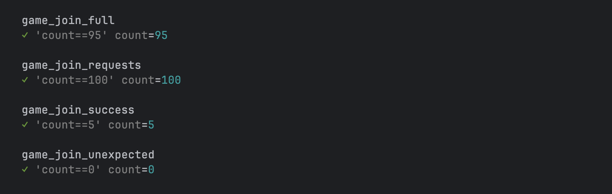
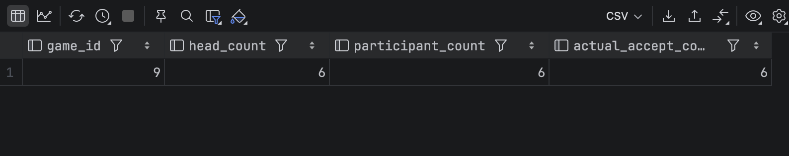

# 경기 참가 동시성 개선 후

같은 경기 행을 `PESSIMISTIC_WRITE`로 조회해 정원 변경을 순서화했다. 정원 6명, 초기 참가 1명인 새 경기에 동시 참가를 요청했다.

## 100 VU 정합성 확인

| 회차 | 성공 | 정원 초과 | 비정상 | 전체 평균 | p95 |
|---|---:|---:|---:|---:|---:|
| Run 2 | 5 | 95 | 0 | 177.07ms | 256.81ms |
| Run 3 | 5 | 95 | 0 | 158.91ms | 212.41ms |

Run 2·3에서 성공·정원 초과·비정상 응답이 모두 기대값과 일치했고 DB에도 생성자를 포함한 `ACCEPT` 6명만 남았다. Run 1은 테스트 데이터 상태가 동일하지 않아 대표 비교에서 제외했다.

정합성 개선을 확인한 후, 같은 로직으로 요청 규모를 확대한 [1,000 VU 본 테스트](../1000-vu/README.md)를 별도로 수행했다.

## 증빙

- [100 VU Run 2 JSON](./k6/run-02-summary.json)
- [100 VU Run 3 JSON](./k6/run-03-summary.json)
