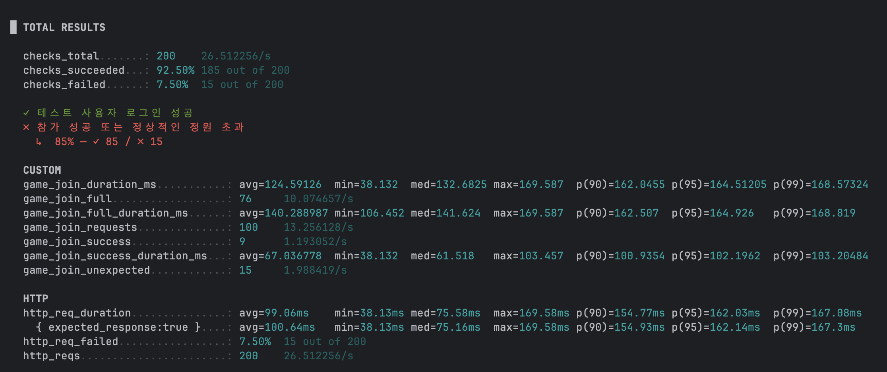
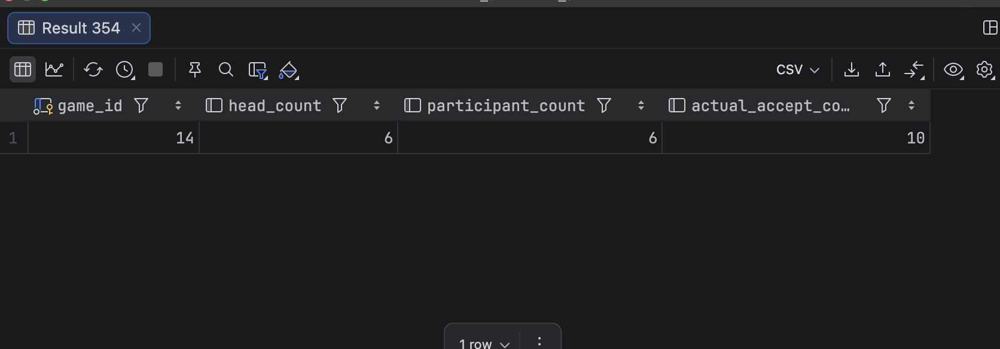

# 경기 참가 동시성 개선 전

정원 6명인 경기에 생성자 1명이 이미 참가한 상태에서, 서로 다른 사용자 100명이 동시에 참가를 요청했다. 남은 자리는 5개이므로 정상 결과는 성공 5건, 정원 초과 거절 95건, 비정상 응답 0건이다.

```http
POST /api/v1/games/{gameId}/participations
```

| 회차 | 성공 | 정원 초과 | 비정상 | 정원 초과 응답 평균 | p95 |
|---|---:|---:|---:|---:|---:|
| Run 2 | 9 | 76 | 15 | 140.29ms | 164.93ms |
| Run 3 | 11 | 74 | 15 | 157.63ms | 195.22ms |

두 회 모두 허용된 5건보다 많은 참가가 성공했고, 15건의 비정상 응답이 발생했다. 응답시간이 짧아도 선착순 정원 불변식을 지키지 못했으므로 실패로 판정한다.

## 증빙



.png>)



- [Run 2 JSON](./k6/run-02-summary.json)
- [Run 3 JSON](./k6/run-03-summary.json)

> Run 1은 이전 출력 형식이어서 최신 JSON 비교에서 제외했다.
